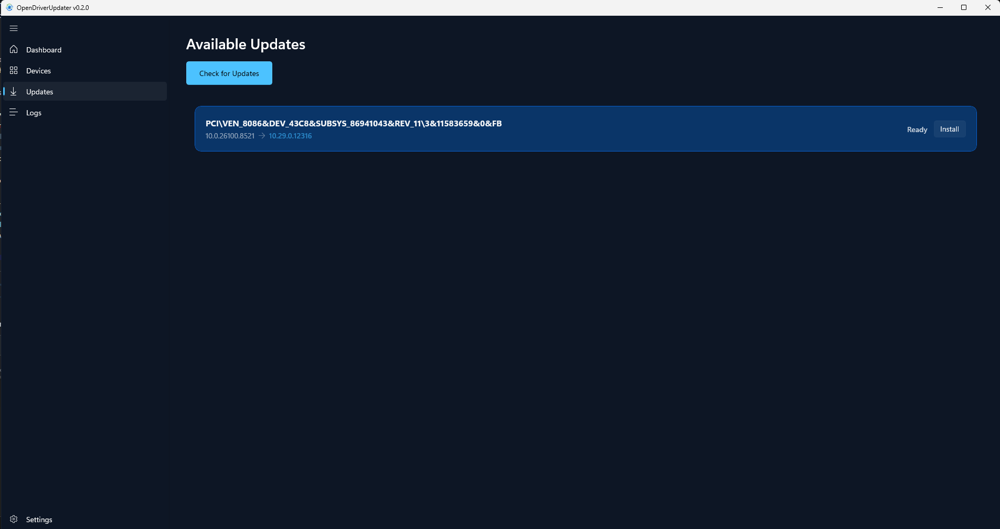

# OpenDriverUpdater

<p align="center">
  
</p>

<p align="center">
  <strong>Safe. Open. Transparent.</strong><br />
  The Driver Updater Windows Actually Needs.
</p>

<p align="center">
  <a href="https://github.com/OpenDriverUpdater/OpenDriverUpdater/actions/workflows/build.yml">
    
  </a>
  <a href="https://github.com/OpenDriverUpdater/OpenDriverUpdater/releases">
    
  </a>
  <a href="LICENSE">
    
  </a>
  <a href="https://dotnet.microsoft.com/">
    
  </a>
  <a href="https://learn.microsoft.com/en-us/windows/apps/winui/">
    
  </a>
</p>

<p align="center">
  <a href="https://github.com/OpenDriverUpdater/OpenDriverUpdater/stargazers">
    
  </a>
  <a href="https://github.com/OpenDriverUpdater/OpenDriverUpdater/network/members">
    
  </a>
  <a href="https://github.com/OpenDriverUpdater/OpenDriverUpdater/graphs/contributors">
    
  </a>
  <a href="https://github.com/OpenDriverUpdater/OpenDriverUpdater/issues">
    
  </a>
  <a href="https://github.com/OpenDriverUpdater/OpenDriverUpdater/commits/main">
    
  </a>
  <a href="https://github.com/OpenDriverUpdater/OpenDriverUpdater/releases">
    
  </a>
</p>

---

## 📸 Preview

<p align="center">
  
</p>

<p align="center"><em>A modern WinUI 3 dashboard and command-line interface for Windows driver management.</em></p>

## ✨ About

**OpenDriverUpdater** is a free and open-source Windows driver management project built around safety, transparency, and user control.

<<<<<<< HEAD
It helps users identify their hardware, find relevant driver updates from trusted sources, verify downloaded packages, and manage installations using native Windows tools.
=======
[](LICENSE)
[](https://dotnet.microsoft.com/)
[](https://learn.microsoft.com/en-us/windows/apps/winui/)
[](https://github.com/OpenDriverUpdater/OpenDriverUpdater)
[](https://odu.crty-dev.com/)
[](https://www.virustotal.com/gui/file/384b1532ef8f9f2368ad1e5ac63a0dc11fd2da8e9b53b479c159eced5cb9f79f/detection)
>>>>>>> 5e17f29 (feat: add GitHub, website, and VirusTotal badges to README)

Our goal is to provide a lightweight, privacy-respecting alternative to commercial driver updater utilities.

### Our principles

- **Safety first** — prioritize trusted sources, signature validation, and file integrity.
- **Transparency** — make driver information and installation actions understandable.
- **User control** — users decide what to download and install.
- **Privacy** — no advertisements, tracking, or bundled software.
- **Open source** — MIT-licensed development with community contributions.

## 🚀 Features

| Feature | Description |
| --- | --- |
| 🔍 **Hardware detection** | Detects devices using Windows Management Instrumentation (WMI) and Plug and Play APIs. |
| 🧠 **Smart driver matching** | Matches driver candidates using hardware IDs and device information. |
| 🛡️ **Trust and safety checks** | Evaluates driver candidates and validates supported digital signatures. |
| 🌐 **Trusted sources** | Integrates with Microsoft Update Catalog and official Intel, AMD, and NVIDIA sources. |
| 🔐 **Download verification** | Supports secure downloads and SHA-256 integrity verification. |
| 📦 **Driver installation** | Uses Windows `pnputil` for native driver package installation. |
| 🖥️ **Desktop application** | Native WinUI 3 interface with a modern dark theme. |
| 🧰 **Command-line interface** | CLI commands for scanning, checking, downloading, installing, and exporting results. |
| 🧾 **Local history** | SQLite-backed storage for supported scan history and update records. |
| 🚫 **No bloat** | No ads, tracking, or bundled third-party applications. |

## 📊 Live project activity

The badges and contributor panel below are generated from public GitHub repository data. They refresh automatically as GitHub updates repository activity. Third-party image services may cache results briefly.

<p align="center">
  <a href="https://github.com/OpenDriverUpdater/OpenDriverUpdater/graphs/contributors">
    
  </a>
</p>

<p align="center">
  <a href="https://github.com/OpenDriverUpdater/OpenDriverUpdater/graphs/contributors">View contributor graph</a>
  ·
  <a href="https://github.com/OpenDriverUpdater/OpenDriverUpdater/graphs/commit-activity">View commit activity</a>
  ·
  <a href="https://github.com/OpenDriverUpdater/OpenDriverUpdater/pulse">View repository pulse</a>
</p>

<p align="center">
  <a href="https://github.com/OpenDriverUpdater/OpenDriverUpdater">
    
  </a>
</p>

> These visualizations are external, automatically refreshed summaries. GitHub remains the source of truth for stars, forks, contributors, releases, and commit history.

## 🧱 Architecture

The solution is organized into independent layers to keep business logic, platform services, user interfaces, and tests maintainable.

```text
OpenDriverUpdater.sln
├── src/
│   ├── OpenDriverUpdater.Core           # Business logic, models, interfaces, and rules
│   ├── OpenDriverUpdater.Infrastructure # Windows APIs, networking, storage, and security
│   ├── OpenDriverUpdater.App            # WinUI 3 desktop application (MVVM)
│   └── OpenDriverUpdater.Cli            # Command-line interface
└── tests/
    ├── OpenDriverUpdater.Core.Tests
    └── OpenDriverUpdater.Infrastructure.Tests
```

| Layer | Responsibility | Dependencies |
| --- | --- | --- |
| **Core** | Business logic, models, interfaces, and rules | None |
| **Infrastructure** | Windows APIs, networking, storage, and security services | Core |
| **App** | Native WinUI 3 desktop interface using MVVM | Core, Infrastructure |
| **CLI** | Command-line tools and automation | Core, Infrastructure |
| **Tests** | Automated tests for core and infrastructure components | Relevant project layers |

## ⚙️ Requirements

- Windows 10 or Windows 11 for the desktop driver-management application.
- .NET 8 SDK.
- Visual Studio 2022 with the **Windows application development** workload for the WinUI 3 app.
- Administrator privileges may be required for certain device and driver operations.

The CLI and selected non-UI components are also built and tested on Linux in CI. Linux support does not mean the Windows driver installation features are available on Linux.

## 🚀 Build and run

Clone the repository:

```powershell
git clone https://github.com/OpenDriverUpdater/OpenDriverUpdater.git
cd OpenDriverUpdater
```

Build the solution and run tests:

```powershell
dotnet restore OpenDriverUpdater.sln
dotnet build OpenDriverUpdater.sln -c Release
dotnet test OpenDriverUpdater.sln -c Release
```

Run a CLI scan:

```powershell
dotnet run --project src/OpenDriverUpdater.Cli -- scan
```

> [!IMPORTANT]
> **Building the WinUI 3 desktop application:** use Visual Studio 2022 with the Windows application development workload and Windows App SDK installed. The standard .NET CLI may not build the WinUI project on a machine without the required Windows development components.

## 🛠️ CLI commands

| Command | Description |
| --- | --- |
| `scan` | Scan the system for connected devices. |
| `list-devices` | List detected hardware and device details. |
| `check-updates` | Search for available driver updates. |
| `download <id>` | Download a selected driver package. |
| `install <path>` | Install a driver package using `pnputil`. |
| `export-json` | Export scan results to JSON. |

Run `--help` with the CLI to inspect the options available in your current build.

## 🔄 Continuous integration

GitHub Actions runs the repository's **Cross-Platform Build & Test** workflow:

- **Windows:** restores and builds the solution, runs tests, and publishes the Windows application artifact.
- **Linux:** builds the supported cross-platform projects, runs core tests, and publishes the Linux CLI artifact.
- **Pull requests and pushes to `main`:** trigger automated build and test checks.

The release-publishing job is intentionally disabled until release signing and distribution requirements are fully configured. Published releases are available on the [Releases page](https://github.com/OpenDriverUpdater/OpenDriverUpdater/releases).

[](https://github.com/OpenDriverUpdater/OpenDriverUpdater/actions/workflows/build.yml)

## 🗺️ Roadmap

The roadmap reflects the project's current development plan. Items may be refined as security reviews, testing, and community feedback progress.

### Phase 1 — Foundation ✅

- [x] Device scanning through WMI and Plug and Play APIs.
- [x] Hardware ID extraction and matching.
- [x] Microsoft Update Catalog integration.
- [x] Initial WinUI 3 desktop application and CLI.

### Phase 2 — Intelligence and utility ✅

- [x] Reduce noise from generic Microsoft and ACPI devices.
- [x] Group duplicate and related device entries.
- [x] Improve device-class categorization.
- [x] Prioritize important device categories such as GPU, Wi-Fi, audio, and storage.
- [x] Add secure streaming downloads and SHA-256 verification.

### Phase 3 — Installation and safety ✅

- [x] Authenticode signature-validation engine.
- [x] Driver installation through native `pnputil`.
- [x] System safety and recovery-related functionality.
- [x] Additional vendor driver-source integrations.
- [x] SQLite-based local history and update records.

### Ongoing work

- [ ] Continue improving hardware and driver matching accuracy.
- [ ] Expand automated tests and security review coverage.
- [ ] Improve documentation and troubleshooting guidance.
- [ ] Make the contribution process easier for new developers.
- [ ] Prepare signed, verifiable release distribution.

## 🤝 Contributing

Contributions are welcome — bug reports, documentation improvements, testing, and code contributions all help the project.

1. Read [CONTRIBUTING.md](CONTRIBUTING.md).
2. Check existing [issues](https://github.com/OpenDriverUpdater/OpenDriverUpdater/issues) or open a new one.
3. Fork the repository and create a focused branch.
4. Make your changes and run the relevant build and tests.
5. Submit a pull request with a clear description of the change.

<p align="center">
  <a href="https://github.com/OpenDriverUpdater/OpenDriverUpdater/graphs/contributors">
    
  </a>
  <a href="https://github.com/OpenDriverUpdater/OpenDriverUpdater/pulls">
    
  </a>
</p>

Please also review our [Code of Conduct](CODE_OF_CONDUCT.md) and [Security Policy](SECURITY.md).

## 🔐 Security

If you discover a security vulnerability, please do not disclose it in a public issue. Follow the responsible disclosure instructions in [SECURITY.md](SECURITY.md).

## 📜 License

OpenDriverUpdater is released under the [MIT License](LICENSE).

Copyright © OpenDriverUpdater Contributors.

## 🔗 Links

- **Website:** https://odu.crty-dev.com
- **GitHub organization:** https://github.com/OpenDriverUpdater
- **Source code:** https://github.com/OpenDriverUpdater/OpenDriverUpdater
- **Issues and bug reports:** https://github.com/OpenDriverUpdater/OpenDriverUpdater/issues
- **Releases:** https://github.com/OpenDriverUpdater/OpenDriverUpdater/releases

---

<p align="center">
  <strong>Safe. Open. Transparent.</strong><br />
  Built for Windows users. Improved by the open-source community.
</p>
